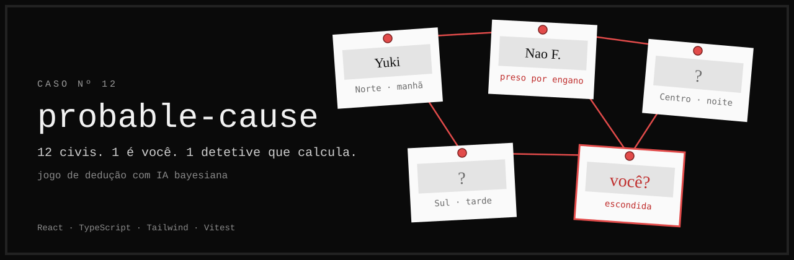
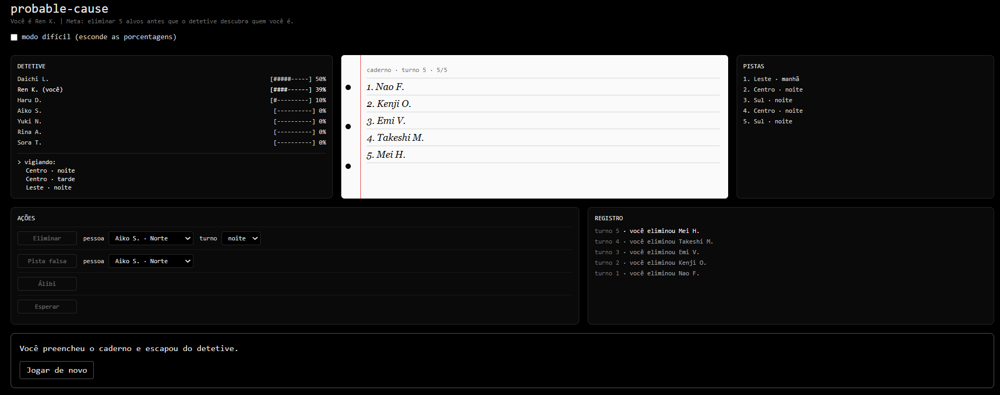

<p align="center">
  
</p>

# probable-cause

[](https://github.com/Paula-Thamyres/probable-cause/actions/workflows/ci.yml) [](LICENSE)

Jogo de dedução em que você é um civil escolhido ao acaso entre 12 e precisa se esconder de um detetive controlado por uma IA bayesiana, que recalcula a suspeita sobre cada civil a cada pista deixada.

Jogue direto no navegador, sem instalar nada: [probable-cause-hazel.vercel.app](https://probable-cause-hazel.vercel.app/)

## 1. O jogo

`suspeita sobre você: █░░░░░░░░░ 12%`

O objetivo é eliminar 5 alvos antes que o detetive descubra quem você é. Você perde se for acusado, se passar de 12 turnos ou se não restarem alvos suficientes.



## 2. Como jogar

`suspeita sobre você: ███░░░░░░░ 35%`

Cada civil tem uma região (Centro, Norte, Sul, Leste ou Oeste) e turnos livres (manhã, tarde ou noite). Você só pode eliminar em um turno em que você mesmo está livre. A cada turno, uma ação:

| Ação | O que faz |
| --- | --- |
| Eliminar | Escolhe pessoa e turno. Deixa uma pista na região do alvo, no turno escolhido. |
| Pista falsa | Deixa uma pista na região de outra pessoa, no primeiro turno livre dela, para desviar a suspeita. |
| Álibi | Reduz pela metade a suspeita sobre você e redistribui o resto entre os outros. |
| Esperar | Passa o turno. |

Modo difícil: uma caixinha no topo esconde as barras e as porcentagens, mantém a lista em ordem fixa e mostra só um nível de alerta (baixo, médio ou alto).

## 3. A IA do detetive

`suspeita sobre você: ██████░░░░ 60%`

A suspeita é uma distribuição de probabilidade sobre os civis, atualizada pela regra de Bayes a cada pista e normalizada para somar 1:

$$\text{posterior} \propto \text{prior} \times \text{verossimilhança}$$

A cada turno o detetive também escolhe 3 pontos para vigiar, entre 15 possíveis (5 regiões por 3 turnos), onde os suspeitos mais prováveis têm mais chance de agir. Uma pista deixada em qualquer ponto vigiado conta como testemunhada e pesa muito mais.

Quando a suspeita sobre alguém chega a 90%, ele acusa. Se for você, o jogo acaba. Se for um inocente, a pessoa é presa, o detetive fica abalado e as crenças se espalham de novo.

Os valores usados no cálculo, como `REGION_MATCH_LIKELIHOOD`, ficam em `src/ai/suspicion.ts`, para ajustar a dificuldade sem mexer no resto.

Por que três civis empatam em 33%? Uma pista só identifica alguém quando o lugar e o turno são exclusivos dessa pessoa. Se três civis do Centro estão livres à noite, uma pista ali deixa os três com a mesma suspeita e ninguém é preso. Já a Yuki é a única do Norte livre de manhã, então uma pista nesse ponto aponta direto para ela.

Limitação conhecida: os pontos vigiados aparecem na tela antes da sua jogada, então ainda dá para desviar deles. O número de pontos vigiados fica em `WATCH_COUNT`, em `src/ai/detective.ts`, para ajustar a dificuldade.

## 4. Arquitetura

`suspeita sobre você: ████████░░ 78%`

```
src/
  ai/           crenças, atualização bayesiana, álibi e detetive que vigia
  game/         regras, estado, ações, acusação, registro de jogadas e nível de alerta
  data/         os 12 civis e os textos em português, inclusive as frases do registro
  hooks/        useGame
  components/   TerminalPanel, DetectivePanel, Notebook, CluesPanel, ActionBar, EventLog
  App.tsx       layout, modo difícil e mensagem de fim de jogo
```

As regras ficam em funções puras e o estado é imutável, então dá para testar tudo sem abrir a interface. São 81 testes em 12 arquivos, ao lado do código (`*.test.ts`).

## 5. Como rodar

`suspeita sobre você: █████████░ 91%`

Precisa do Node (testado com a versão 24).

```bash
npm install
npm run dev      # abre em http://localhost:5173/
npm test
npm run build
npm run lint
```

Saída do `npm test`:

```
 ✓ src/game/alert.test.ts (4 tests)
 ✓ src/ai/countermeasures.test.ts (6 tests)
 ✓ src/ai/suspicion.test.ts (7 tests)
 ✓ src/ai/detective.test.ts (6 tests)
 ✓ src/game/state.test.ts (3 tests)
 ✓ src/game/selectors.test.ts (5 tests)
 ✓ src/data/eventMessages.test.ts (6 tests)
 ✓ src/game/watch.test.ts (7 tests)
 ✓ src/game/accusation.test.ts (8 tests)
 ✓ src/game/events.test.ts (8 tests)
 ✓ src/game/actions.test.ts (16 tests)
 ✓ src/game/outcome.test.ts (5 tests)

 Test Files  12 passed (12)
      Tests  81 passed (81)
```

O GitHub Actions roda lint, testes e build a cada envio para a `main`. O resultado aparece no selo do topo.

## 6. Licença

`suspeita sobre você: ██████████ 100%`

Projeto distribuído sob a licença MIT. O texto completo está em [LICENSE](LICENSE).

---

Se você chegou até aqui, o detetive já tem o seu nome.
